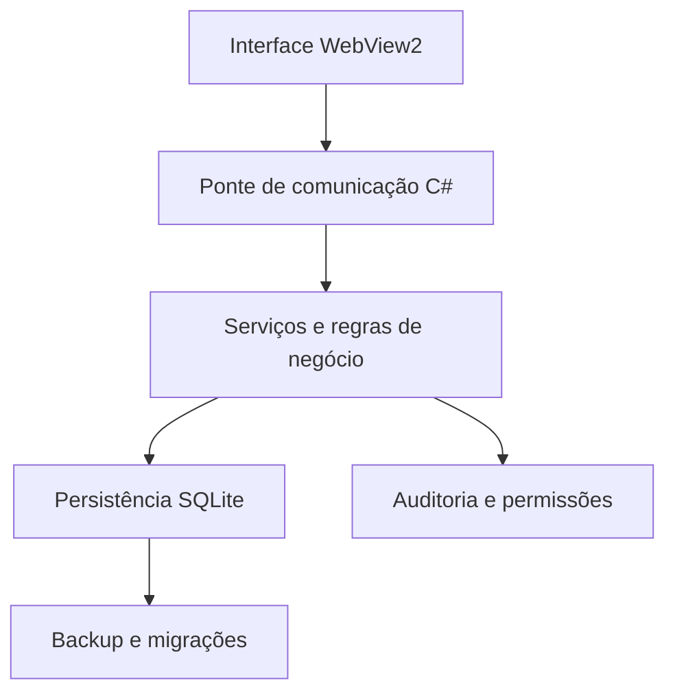

# CaixaLume — Sistema de Gestão e PDV

**Aplicação desktop de gestão comercial desenvolvida em C#/.NET 10, com Windows Forms, WebView2 e SQLite.**

O CaixaLume é um projeto de software voltado à operação de pequenos comércios. Reúne frente de caixa (PDV), estoque, gestão de usuários, movimentações financeiras e relatórios. Foi desenvolvido com atenção especial a **regras de negócio, integridade dos dados, controle de acesso e testes de integração**.

> **Status:** versão de teste **0.1.3**. Projeto em evolução; ainda não está homologado para uso fiscal ou operação comercial em produção.

## Tecnologias

| Camada | Tecnologia |
| --- | --- |
| Aplicação desktop e serviços | C# / .NET 10, Windows Forms |
| Interface | HTML, CSS, JavaScript, WebView2 |
| Persistência | SQLite |
| Qualidade | Testes de integração em .NET |
| Distribuição | Publicação e instalador para Windows |

## Arquitetura resumida



A interface HTML/CSS/JavaScript funciona localmente dentro do aplicativo Windows. A comunicação com os serviços .NET ocorre por uma ponte WebView2, mantendo as regras de negócio na aplicação C#.

## Funcionalidades

- **PDV e vendas:** pesquisa por produto ou código de barras, carrinho, descontos e acréscimos configuráveis, pagamento em dinheiro/PIX/cartão, troco e confirmação de venda.
- **Estoque:** cadastro de produtos por unidade ou peso, entradas, saídas, ajustes, validade, fornecedores e histórico.
- **Caixa e financeiro:** abertura, suprimento, sangria, despesas, conferência, fechamento e histórico.
- **Relatórios:** vendas, faturamento, custos, estimativa de lucro bruto e margem; exportações em PDF/Excel.
- **Usuários e segurança:** perfis e permissões, auditoria de ações e derivação de senhas com PBKDF2-SHA256 e salt aleatório.
- **Confiabilidade:** operações transacionais, proteção contra repetição de checkout, migrações versionadas e rotinas de backup/restauração.

## Decisões técnicas e desafios

**Integridade financeira:** vendas e alterações críticas precisam preservar a consistência entre registros, estoque e caixa. O projeto utiliza operações transacionais e testes para cenários de venda, cancelamento e movimentação.

**Evolução do banco de dados:** migrações são registradas em `SchemaMigrations`, executadas em transação e precedidas de snapshot do banco existente.

**Controle de acesso:** separação de operações administrativas e de operador, com permissões verificadas pelos serviços e trilhas de auditoria.

**Recuperação:** backups consistentes do SQLite e validações durante a restauração. Imagens locais ainda exigem cópia separada para recuperação em outro computador.

## Executar localmente

**Requisitos:** Windows e SDK .NET 10. Para executar a partir do código-fonte:

```powershell
git clone https://github.com/gabryelle-lima/CaixaLume.git
cd CaixaLume
dotnet restore
dotnet run
```

O banco SQLite é armazenado no perfil local do Windows, em `%LOCALAPPDATA%\CaixaLume\dados\caixalume.db` nas instalações novas (instalações anteriores continuam usando o banco existente). No primeiro acesso, crie o usuário administrador e abra o caixa antes de registrar vendas.

Para instalação por pacote e atualização preservando os dados, consulte [Instalação e Operação](docs/INSTALACAO_E_OPERACAO.md), [Atualizações](docs/ATUALIZACOES.md) e [Releases](https://github.com/gabryelle-lima/CaixaLume/releases), quando disponíveis.

## Testes

```powershell
dotnet build
dotnet build Tests/CaixaLume.IntegrationTests/CaixaLume.IntegrationTests.csproj --no-restore
dotnet run --project Tests/CaixaLume.IntegrationTests/CaixaLume.IntegrationTests.csproj --no-build --no-restore
```

Os testes de integração abrangem autenticação, migrações, estoque, vendas, cancelamentos, caixa, despesas, relatórios e backup/restauração, utilizando bancos de teste temporários. Consulte também [Auditoria do PDV](docs/auditorias/AUDITORIA_PDV.md), [Análise de UX](docs/auditorias/ANALISE_UX.md) e [Auditoria de Arquitetura](docs/ARCHITECTURE_AUDIT.md).

## Limitações e próximos passos

O sistema **não emite NFC-e/NF-e** e não integra com SEFAZ, SAT/MFE, adquirentes, TEF ou conciliação bancária. Ainda requer avaliação fiscal/contábil, testes de recuperação em implantação real e revisão das rotinas de segurança e operação antes do uso comercial.

## Sobre o projeto

O CaixaLume compõe meu portfólio de desenvolvimento de software, reunindo problemas reais de gestão comercial e decisões técnicas que envolvem banco de dados, segurança, testes, arquitetura e experiência do usuário.

**Desenvolvimento:** [Gabryelle Lima](https://github.com/gabryelle-lima)

## Organização do projeto

- `CaixaLume.csproj`: aplicativo Windows; `Forms`, `Web`, `Services`, `Data` e `Models` separam interface, regras e persistência.
- `Server`: servidor de gestão de instalações e acesso administrativo.
- `Tests/CaixaLume.IntegrationTests`, `Tests/CaixaLume.Management.UnitTests` e `Tests/Web`: testes automatizados.
- `scripts`: instalação, execução, publicação e manutenção; os atalhos da Área de Trabalho abrem as funções de uso diário.
- `docs/auditorias`: relatórios das etapas anteriores; demais manuais e roteiros em `docs`.
- `artifacts`: resultados locais de compilação e validação, ignorados pelo Git.

A identidade interna dos projetos é CaixaLume. As variáveis `CAIXALUME_DATABASE` e `CAIXALUME_AMBIENTE` substituem os nomes anteriores, que continuam aceitos por compatibilidade. O banco e as imagens já existentes não são removidos nem transferidos automaticamente. Veja [padronização](docs/PADRONIZACAO_CAIXALUME.md).

## Servidor de gestão e validação completa

O projeto inclui o servidor ASP.NET Core em `Server/CaixaLume.Management.csproj`, com SQLite próprio, cadastro de estabelecimentos e acompanhamento de instalações. O painel possui conta administrativa, senha, autenticador e sessões revogáveis. Ele não recebe vendas nem fornece controle remoto do computador. Consulte [Gestão central](docs/GESTAO_CENTRAL.md) e [Acesso ao Aurora](docs/ACESSO_PAINEL_AURORA.md).

Os testes específicos podem ser executados após a compilação:

```powershell
dotnet run --project Tests/CaixaLume.IntegrationTests/CaixaLume.IntegrationTests.csproj --no-build -- --security
dotnet run --project Tests/CaixaLume.IntegrationTests/CaixaLume.IntegrationTests.csproj --no-build -- --financial
dotnet run --project Tests/CaixaLume.IntegrationTests/CaixaLume.IntegrationTests.csproj --no-build -- --stock
dotnet run --project Tests/CaixaLume.IntegrationTests/CaixaLume.IntegrationTests.csproj --no-build -- --ux
dotnet run --project Tests/CaixaLume.IntegrationTests/CaixaLume.IntegrationTests.csproj --no-build -- --central
dotnet run --project Tests/CaixaLume.Management.UnitTests/CaixaLume.Management.UnitTests.csproj
node --test Tests/Web/*.test.js
dotnet build Server/CaixaLume.Management.csproj
python Tests/management_server_test.py
```

A suíte Python de HTTPS também requer o pacote `cryptography`. Resultado local desta padronização: **224 verificações aprovadas**, sem contar interrupções como aprovação. Os testes de recuperação usam arquivos temporários e precisam de permissão para mover arquivos. A validação visual completa no equipamento de uso e a atualização da instalação Linux são verificações separadas.
