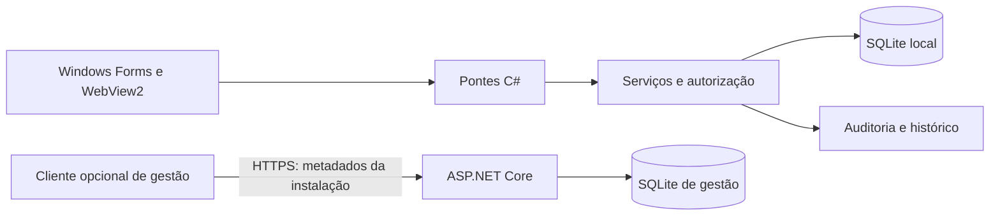

# CaixaLume — Gestão comercial e ponto de venda

Aplicação para a operação de pequenos mercados, com **C#/.NET 10, Windows Forms, WebView2 e SQLite**. Reúne vendas, estoque, caixa, usuários e relatórios em um aplicativo Windows que opera localmente, sem depender de conexão com a internet para registrar vendas.

**Estado do projeto:** versão de teste 0.1.3, em evolução. A implementação atual contém melhorias posteriores ao pacote publicado dessa versão. Ainda requer validação de implantação e avaliação fiscal antes do uso comercial em produção.

## Problema e solução

O CaixaLume organiza a rotina do operador — localizar produtos, cobrar, registrar pagamentos e fechar o caixa — mantendo a consistência entre venda, estoque e movimentação financeira. O servidor de gestão é opcional e separado: acompanha estabelecimentos e instalações sem receber o histórico de vendas nem bloquear a operação local quando estiver indisponível.

## Funcionalidades

- **Vendas:** busca por nome ou código de barras, produtos UN/KG, quantidades fracionárias por peso, descontos e acréscimos configuráveis, pagamentos mistos e troco.
- **Caixa:** abertura, suprimento, sangria, despesas, conferência e fechamento com histórico.
- **Estoque:** cadastro, entradas, saídas, ajustes auditados, estoque mínimo, validade, categorias e fornecedores.
- **Consultas:** histórico de vendas paginado, cancelamentos administrativos, relatórios e exportações.
- **Segurança:** senhas derivadas com PBKDF2-SHA256, permissões por perfil/usuário, autorização no backend e proteção do último administrador ativo.
- **Gestão de instalações:** serviço ASP.NET Core com SQLite independente, vínculo por convite temporário, revogação de dispositivos e painel com senha, autenticador TOTP e sessões revogáveis.

Os pagamentos são registrados manualmente pelo operador. O sistema não simula confirmação bancária. A importação de XML de compra auxilia a entrada de mercadorias; não constitui emissão fiscal.

## Arquitetura



As regras financeiras, permissões e persistência permanecem no backend C#. A interface HTML/CSS/JavaScript é carregada localmente no WebView2. O banco transacional de cada instalação e o registro central de dispositivos têm responsabilidades distintas.

| Decisão | Aplicação no projeto |
| --- | --- |
| Transações SQLite | Venda, itens, estoque, pagamentos e movimentações são confirmados em conjunto. |
| Identificador de operação | Reenvios e duplo clique reutilizam a venda; conteúdo divergente é recusado. |
| Valores monetários | Cálculos e arredondamentos no backend, com pagamentos persistidos em centavos. |
| Migrações versionadas | Atualizações compatíveis com bancos existentes e snapshot antes de migrações. |
| Auditoria | Alterações administrativas e de estoque registram usuário, motivo e histórico. |
| Recuperação | Backup consistente e validação de integridade na restauração. |

## Executar o aplicativo

Requisitos: Windows, SDK .NET 10 e runtime WebView2. Em um terminal:

```powershell
git clone https://github.com/gabryelle-lima/CaixaLume.git
cd CaixaLume
dotnet restore CaixaLume.csproj
dotnet run --project CaixaLume.csproj
```

No primeiro acesso, crie o administrador. Depois cadastre os produtos e abra o caixa. Instalações novas usam `%LOCALAPPDATA%/CaixaLume/dados/caixalume.db`; instalações anteriores preservam o banco existente. Não há usuário ou senha padrão.

Para uma demonstração com banco separado, consulte o [guia de demonstração](docs/DEMONSTRACAO.md). Para instalar pacotes e atualizar, consulte [instalação e operação](docs/INSTALACAO_E_OPERACAO.md).

## Testes e evidências

```powershell
dotnet build Tests/CaixaLume.IntegrationTests/CaixaLume.IntegrationTests.csproj
dotnet run --project Tests/CaixaLume.IntegrationTests/CaixaLume.IntegrationTests.csproj --no-build
```

A execução local completa da [base de referência](https://github.com/gabryelle-lima/CaixaLume/commit/c31a7114d5dbe45311d93cbed5d19cf4be19b57d), em **02/11/2026**, concluiu **224 verificações**: 76 gerais, 13 de segurança, 20 financeiras, 15 de estoque, 8 de interface, 12 do cliente de gestão, 54 do servidor, 6 vetores TOTP e 20 de JavaScript. Esse resultado é um registro de execução local, não uma garantia de aprovação em qualquer ambiente nem de homologação comercial.

A cobertura inclui reenvios concorrentes, falhas durante gravação, interrupção forçada do processo, cancelamentos, proteção de usuários e restauração de backups. Veja [comandos, dependências e limites da validação](docs/TESTES.md).

## Navegação pelo código

| Diretório | Responsabilidade |
| --- | --- |
| `Forms`, `Web` | Interface Windows e telas locais do WebView2. |
| `Services`, `Models`, `Data` | Regras de negócio, modelos, repositórios e migrações. |
| `Server` | API e painel de gestão de instalações. |
| `Tests` | Testes de integração, interface, JavaScript e autenticação. |
| `scripts` | Compilação, validação, publicação e instalação. |
| `docs` | Guias técnicos, decisões e relatórios históricos. |

Comece por [VendaService](Services/VendaService.cs), [VendaRepository](Data/VendaRepository.cs), [Autorizacao](Services/Autorizacao.cs) e pelos [cenários financeiros](Tests/CaixaLume.IntegrationTests/FinancialScenarios.cs).

## Limitações e próximos passos

- Não emite NFC-e/NF-e nem integra com SEFAZ, TEF, adquirentes ou conciliação bancária.
- A importação de XML tem limitações documentadas, incluindo o tratamento de CNPJ.
- Imagens locais precisam de cópia separada na recuperação em outro computador.
- A interface e os periféricos exigem validação no equipamento de uso.
- A implantação ainda precisa consolidar testes de atualização, recuperação e operação em piloto real.

Consulte o [roadmap](docs/ROADMAP.md), a [gestão central](docs/GESTAO_CENTRAL.md) e o [índice da documentação](docs/README.md).

## Sobre o desenvolvimento

Projeto de portfólio e aprendizado conduzido por [Gabryelle Lima](https://github.com/gabryelle-lima), com apoio de IA na implementação e revisão do código. O repositório reúne o produto, suas decisões técnicas e evidências de testes.
